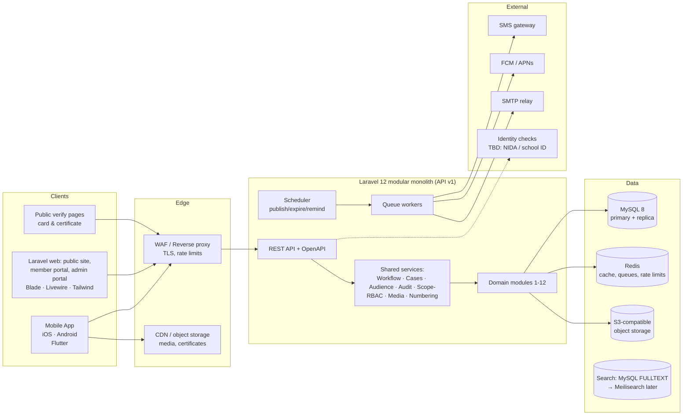
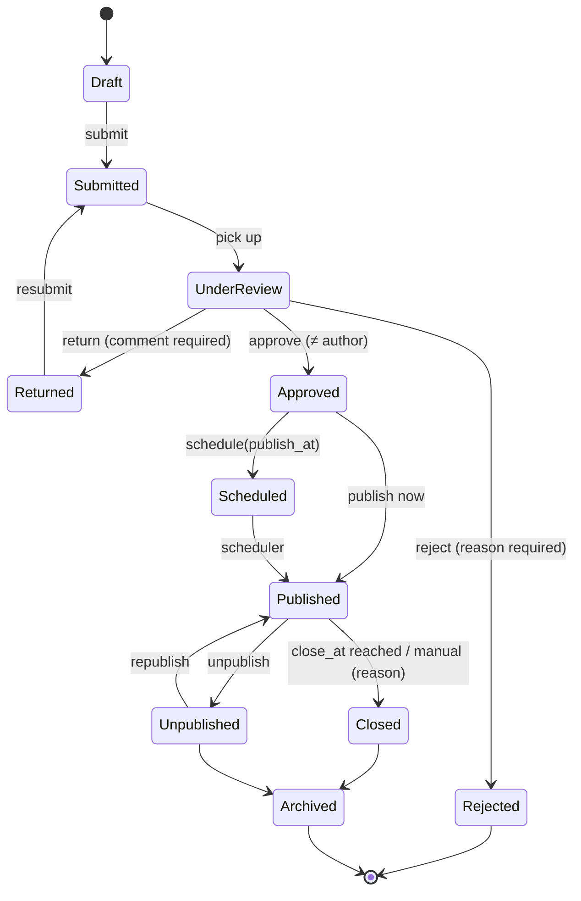

# 02 — Solution Architecture

## 1. Goals that drive the design

| Driver | Source | Architectural response |
|---|---|---|
| Three interfaces (Mobile, Web, Admin Portal) over one dataset | SRS §1.0 | One API-first backend; two front-end codebases (member app, admin portal) |
| Learners in secondary schools on low-end Android and poor connectivity | LRN-REQ05, REG-REQ01 risks | Lightweight mobile client, offline cache, compressed media, SMS fallback |
| Many minors on the platform | PRO-REQ03, MNT-REQ06, SAF-REQ05 | Age category on every user; safeguarding policy layer enforced server-side |
| The same workflow repeated in 6 modules (Draft → Review → Approved → Published → Closed → Archived) | LRN, OPP, GAM, CMP, EVT, ALM | One reusable **Publishing Workflow** service |
| The same "case" pattern repeated in 4 places (reference no., assign, status, respond, close) | COM-REQ01-04, FBK, SAF, MNT-REQ06 | One reusable **Case Management** service |
| Audit on nearly every requirement | all modules | Append-only **Audit Log** service, written by model observers |
| Geographic / institutional scope for coordinators and patrons | INS-REQ06, INS-REQ07 | **Scoped RBAC**: permission + scope (national / region / district / institution / club) |
| Audience targeting in 7 modules | LRN-REQ04, OPP-REQ05, GAM-REQ04, CMP-REQ01, EVT-REQ03, NOT-REQ03, COM-REQ05 | One **Audience Rule** model, evaluated in a single query scope |

## 2. Target architecture



### 2.1 Why a modular monolith (not microservices)
The team is small, the domain is cohesive and the load is modest (projected national membership in the tens to low hundreds of thousands). A modular monolith keeps one deployment and one database transaction boundary, while hard module boundaries (`app/Domain/<Module>`) keep the option to extract a service later, for example Notifications.

## 3. Technology stack

| Concern | Choice | Notes |
|---|---|---|
| Application | **Laravel 13 / PHP 8.3**, one app in `backend/` serving the web front end and `/api/v1`. Sanctum tokens for mobile; session auth for the web | See ADR 001 |
| Web front end | **Blade + Livewire 4 (Alpine.js) + Tailwind CSS 4**, server-rendered, built with Vite | Public website (SEO), member portal and Administration Portal in one codebase. No React |
| SEO | Server-rendered HTML, canonical + `hreflang` (sw at `/`, en at `/en`), Open Graph, JSON-LD, dynamic `sitemap.xml` and `robots.txt` | Already implemented in the foundation branch |
| API contract | **OpenAPI 3.1** generated from code (e.g. `dedoc/scramble`) | Dart client generated for the Flutter app |
| Database | **MySQL 8.0** (InnoDB, utf8mb4), UUID PKs | Read replica for reporting from Release 3 |
| Cache / queue / locks | **Redis 7** + Laravel queues (+ Horizon dashboard) | Notifications, scoring, certificate PDFs |
| Scheduler | Laravel Scheduler (`schedule:work` under supervisor) | Scheduled publish, auto-close, reminders, waitlist expiry |
| Files | S3-compatible storage (MinIO on-prem, or cloud) + signed URLs | Virus scan on upload (ClamAV) |
| Search | MySQL FULLTEXT first; Meilisearch if relevance needs grow | LRN-REQ07, OPP-REQ04 |
| PDF / QR | `barryvdh/laravel-dompdf` (or Browsershot), `bacon/bacon-qr-code` | Certificates, membership card |
| Mobile app | **Flutter 3 (Dart)** for iOS and Android | Performs well on low-end Android; one codebase for both stores |
| Mobile libs | Riverpod (state), dio + generated OpenAPI client, drift/Hive (offline cache), flutter_secure_storage, mobile_scanner (QR), firebase_messaging, intl (en/sw) | |

**Why not React or React Native:** the web front end is now server-rendered Laravel (ADR 001), so a React Native app would no longer share code with the web. Flutter gives the best performance on the low-end Android phones many students use.

**New dependencies need approval.** The backend `CLAUDE.md` asks for approval before changing dependencies. Each package above is listed in the Release 0 change request.

## 4. Shared platform services (build first — Release 0/1)

### 4.1 Publishing Workflow (`HasPublishingWorkflow` trait)
Used by: Content, Quiz, Opportunity, Competition, Event/Campaign, Alumni Session, Q&A answers, Rewards.


- Columns: `status`, `submitted_at/by`, `reviewed_at/by`, `review_comment`, `publish_at`, `expires_at|close_at`, `published_at/by`, `archived_at/by`.
- `workflow_transitions` table stores every transition (actor, from, to, comment, timestamp), which satisfies the "record reviewer, decision, date and time" sub-requirements.
- **Four-eyes rule**: the author cannot approve their own item (LRN-REQ02 §9, GAM-REQ03).
- Per-type config sets whether approval is required (EVT-REQ01 says "where approval is required").

### 4.2 Case Management (`Case` model with typed subtypes)
Used by: Ask-TRA questions (COM-REQ01-04), Feedback (FBK-REQ01-04), Moderation reports (COM-REQ07/08, SAF-REQ01-06), Safeguarding concerns (MNT-REQ06, SAF-REQ05).
- Reference numbers such as `Q-2026-000123`, `FB-…`, `MOD-…` from the Numbering service.
- Category, priority, assignee (user or team), SLA timers, internal notes vs. public responses, status history, linked cases (duplicates).
- `restricted` flag for safeguarding cases. Only holders of `view_safeguarding_cases` within scope can read them.

### 4.3 Audience Rules
`audience_rules(targetable_type, targetable_id, dimension, operator, value, is_hard)`, with dimensions such as membership_category, education_level, institution, institution_category, region, district, club, age_band and role.
- `scopeVisibleTo(User $u)` is applied to every member-facing list query.
- `is_hard = false` means an informational recommendation only (OPP-REQ05 §5).
- The same rules power notification audiences (NOT-REQ03) and their "preview audience" count.

### 4.4 Audit Log
- Append-only `audit_logs` table: actor, action, auditable type/id, before/after JSON diff, IP, user agent, reason, case reference.
- Written automatically by an `Auditable` trait on models and explicitly for security events (login success/failure, recovery, role change).
- No update or delete API exists. The DB user for the app has `INSERT, SELECT` only on this table. An admin viewer filters by actor, entity and date.

### 4.5 Scoped RBAC
Extends the prototype's modules/controls:
- `user_roles` gains `scope_type` (`national|region|district|institution|club`), `scope_id`, `starts_at`, `ends_at`. This covers patron and coordinator assignment history (INS-REQ05/06).
- `permission:slug` middleware is kept. Laravel **Policies** add scope checks (e.g. a coordinator in Arusha can verify only Arusha registrations).
- Seeded roles: Member-Student, Member-Alumni, Patron, TRA Coordinator, Tax Education Officer, Content Officer, Content Reviewer, Subject Matter Expert, Moderator, Safeguarding Officer, Mentor, Event Organizer, Notification Officer, Report Viewer, System Administrator, Super Admin.

### 4.6 Numbering service
Collision-free, human-friendly identifiers generated from a DB sequence table under a row lock:
- Membership number: e.g. `TC-<YY>-<REGION>-<000000>-<check digit>`, issued **on activation**, not at registration (MEM-REQ01). The final format needs TRA approval (decision D-03).
- Registration ref `REG-…`, Certificate ID `CERT-…` (plus a random verification token in the QR code), Question `Q-…`, Feedback `FB-…`, Case `MOD-…`.

### 4.7 Notification service
- One `NotificationDispatcher` turns a domain event into a resolved template (en/sw), works out the channels (template config ∩ user preferences ∪ mandatory), then queues a delivery per channel.
- `notifications` (inbox, read status) and `notification_deliveries` (channel, status, attempts, provider id, error code).
- An idempotency key `(event_type, subject_id, user_id, channel)` prevents duplicates (NOT-REQ02 §5, NOT-REQ07 §7).
- Retries use exponential backoff up to the configured limit and stop there. Admins can resend manually.

### 4.8 Media service
Upload is validated by MIME and size and virus-scanned, and lands in private storage. Images get thumbnails. Video gets low/medium renditions (optional HLS in a later release). The app receives signed URLs, and the mobile client picks a rendition by connection type (LRN-REQ05 §8).

## 5. Module (domain) structure in the backend

```
app/
  Domain/
    Shared/        Workflow, Cases, Audience, Audit, Numbering, Media, Scope
    Accounts/      M1  registration, verification, auth, recovery, status
    Membership/    M2  profile, privacy, number, card, verification
    Institutions/  M3  institutions, clubs, patrons, coordinators, stats
    Learning/      M4  content, categories, modules/lessons, progress, versions
    Community/     M5  Q&A, spaces, posts, collaboration groups
    Alumni/        M6  alumni, directory, sessions, mentorship
    Opportunities/ M7
    Gamification/  M8  quizzes, attempts, points ledger, badges, leaderboards
    Competitions/  M9  competitions, entries, results, rewards, certificates
    Events/        M10 events, registrations, waitlist, check-in, materials
    Notifications/ M11
    Safety/        M12 feedback, moderation, safeguarding
    Reporting/     (proposed M13)
  Http/Controllers/API/V1/<Module>/...   thin controllers
  Http/Requests/...                      FormRequest validation
  Http/Resources/...                     API Resources (no raw models)
  Policies/...
```
Rule: controllers handle validation and authorisation and delegate to an Action/Service class. Domain events (e.g. `MembershipActivated`) decouple modules from Notifications, Gamification and Audit.

## 6. Member experience (Flutter app and Livewire member portal)

| Area | Screens (MVP in bold) |
|---|---|
| Onboarding | **Language select (en/sw)**, **Register (multi-step, institution search, consent)**, **Pending verification status**, **Login (phone/email + password, OTP)**, **Recover account** |
| Home | **Personalised feed (targeted content, events, quizzes)**, notifications badge |
| Membership | **Profile**, **Digital card with QR (works offline, shows "last verified")**, privacy settings, alumni transition request |
| Learn | **Categories**, **Content viewer (article/video/infographic/PDF)**, **Module progress**, search |
| Play | **Quizzes (timer, navigation, results)**, points, badges, leaderboards, competitions |
| Events | List, detail, RSVP/waitlist, my tickets (QR), materials |
| Opportunities | Hub, filters, saved, career resources |
| Community | Ask TRA, my questions, Q&A knowledge base, spaces, posts, report |
| Alumni & Mentorship | Directory, sessions, mentor application, mentorship request/tracker |
| More | Notification inbox and preferences, feedback, settings, help |

The member web portal (Livewire) offers the same journeys in the browser. Offline (mobile): API responses are cached locally with drift/Hive. Content can be downloaded for offline reading. Quiz attempts start online (for time-limit integrity) but tolerate brief drops by queuing the submission with the server-issued start time.

## 7. Environments

| Env | Purpose | Data |
|---|---|---|
| Local | Docker Compose (php-fpm, nginx, mysql, redis, minio, mailpit) | Seeders + factories |
| Dev/Integration | Auto-deploy on merge to `main` | Synthetic |
| Staging/UAT | Release candidates; TRA UAT | Anonymised/synthetic, never real minors' data |
| Production | TRA-approved hosting (to be confirmed: TRA data centre / government cloud) | Live |

Hosting location, data residency and e-Government standards compliance are open decisions (D-01, D-02 in doc 09).
