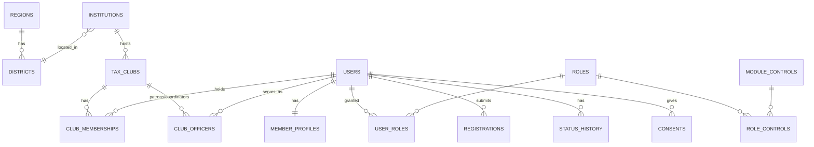

# 03 — Logical Data Model

Conventions: UUID primary keys named `id` in new tables (existing `*_id` names are kept for the prototype tables until the refactor in Release 0), `created_at/updated_at` on every table, soft deletes (`deleted_at`) on member-facing records, monetary values in TZS minor units, timestamps in UTC (displayed as Africa/Dar_es_Salaam).

## 1. Core: accounts, membership, institutions

| Table | Key columns | Notes / SRS |
|---|---|---|
| `regions`, `districts` | code, name | Master data (31 regions). Replaces free-text region |
| `institutions` | id, code (unique, generated), name, category `secondary/college/university`, district_id, contacts JSON, has_tax_club, status `active/inactive/pending`, created_by | INS-REQ01-03. Duplicate check on normalised name + district |
| `institution_status_history` | institution_id, from, to, reason, actor, at | INS-REQ03 |
| `tax_clubs` | id, institution_id, name, established_on, status, member_count (cached) | INS-REQ04. Unique active club per institution unless config allows more |
| `club_officers` | club_id/institution_id/region_id (scope), user_id, role `patron/coordinator`, starts_at, ends_at, assigned_by | INS-REQ05/06, history kept |
| `users` | id, phone (unique, E.164), email (nullable unique), password, membership_category `secondary/college/university/alumni/staff`, account_status, age_band `minor/adult`, preferred_language, last_login_at, failed_logins, locked_until | REG-REQ04/06, PRO-REQ03 |
| `member_profiles` | user_id, full_name, dob, gender, photo_path, interests JSON, bio, career fields (alumni), privacy JSON (`directory_visible`, `show_institution`, …) | PRO-REQ01-03, ALM-REQ01 |
| `registrations` | id, reference_no, user_id, institution_id, club_id, category, submitted_payload JSON, status `pending/verified/rejected`, decided_by, decided_at, rejection_reason | REG-REQ01/02 |
| `consents` | user_id, type `terms/privacy/guardian`, version, guardian_name/phone, given_at, ip | REG-REQ01 (minors), PDPA |
| `memberships` | user_id, membership_no (unique), status `pending_verification/verified/active/suspended/inactive/rejected/alumni`, activated_at, alumni_at | MEM-REQ01/04 |
| `membership_status_history` | membership_id, from, to, reason, actor (user or `system`), at | MEM-REQ04, REG-REQ06 |
| `club_memberships` | user_id, club_id, joined_at, left_at, is_current | Keeps institution history after alumni transition (REG-REQ07) |
| `verification_logs` | identifier, result, verifier_id, at, ip | MEM-REQ03, CER-REQ02 |
| `login_events` | user_id (nullable), identifier, success, reason, ip, user_agent, at | REG-REQ04 |
| `password_reset_codes` / `otp_codes` | user_id, channel, code_hash, expires_at, used_at, attempts | REG-REQ05 |
| `account_restrictions` | user_id, type `warning/feature_restriction/suspension/deactivation`, features JSON, starts_at, ends_at, reason, case_id, actor, lifted_at/by | REG-REQ06, SAF-REQ04 |

**Account status vs membership status:** `users.account_status` (`active/suspended/deactivated/locked`) controls *login*; `memberships.status` controls *programme standing*. One service (`AccessStateResolver`) derives effective access from both plus active restrictions, as SAF-REQ04 §9 requires ("avoid conflicting access states").

## 2. Shared services

| Table | Purpose |
|---|---|
| `workflow_transitions` | (subject_type, subject_id, from, to, actor_id, comment, at): history for all publishable items |
| `audience_rules` | (targetable_type, targetable_id, dimension, operator `in/not_in/gte/lte`, values JSON, is_hard) |
| `cases` | id, type `question/feedback/report/safeguarding/mentor_concern`, reference_no, category_id, priority, status, subject (polymorphic: post, comment, user, mentorship), reporter_id, assignee_id/team_id, is_restricted, is_urgent, sla_due_at, resolution |
| `case_events` | case_id, kind `note/public_response/assignment/status/escalation/link`, body, visibility `internal/reporter`, actor, at |
| `audit_logs` | id, actor_id, action, auditable_type/id, before JSON, after JSON, reason, ip, ua, at (append-only) |
| `sequences` | name, prefix, year, next_value, for reference numbers |
| `media` | id, owner (polymorphic), disk, path, mime, size, checksum, scan_status, renditions JSON |
| `categories`, `tags`, `taggables` | Typed categories (`content/question/opportunity/feedback/report`), active flag (LRN-REQ04 §8) |

## 3. Learning & content (M4)

| Table | Key columns |
|---|---|
| `contents` | id, code, type `article/video/image/infographic/document/faq/case_study/module`, title, summary, objectives, current_version_id, workflow columns (doc 02 §4.1), review_due_at |
| `content_versions` | content_id, version_no, body (HTML sanitised), media_ids, change_reason, author_id, approved_by, effective_at, status |
| `learning_modules` / `lessons` | module = content of type `module`; lessons ordered, `is_mandatory` |
| `learning_progress` | user_id, module_id, lesson_id, status `not_started/in_progress/completed`, position (e.g. video seconds), version_id, started_at, completed_at |
| `content_views` | user_id, content_id, at, duration, source (analytics) |

The prototype's `content`/`user_progress` data migrates into `contents` + `content_versions` (v1) and `learning_progress`.

## 4. Quiz, gamification, competitions (M8, M9)

| Table | Key columns |
|---|---|
| `quizzes` | + mode `practice/scored`, pass_mark_pct, time_limit_sec, max_attempts, retained_result `highest/latest/first`, show_answers `never/after_submit/after_close`, opens_at, closes_at, category_id, module_id, workflow columns |
| `quiz_questions` | + type `single/true_false/multiple`, media_id, explanation, points |
| `quiz_answers` | unchanged |
| `quiz_attempts` | + started_at, submitted_at, expires_at, status `in_progress/submitted/auto_submitted/void`, is_counted |
| `point_rules` | activity `quiz_pass/quiz_score/lesson_complete/module_complete/event_attended/…`, points, repeatable, effective_from/to |
| `point_transactions` | user_id, rule_id, source (polymorphic), points (±), reason, actor (for corrections), idempotency_key UNIQUE |
| `badges`, `user_badges` | criteria JSON, repeatable flag, active; awarded_at |
| `leaderboards`, `leaderboard_snapshots` | metric, scope `individual/institution/region`, period `weekly/monthly/annual`, enabled; materialised ranks |
| `competitions` | category, objective, opens/closes, registration_required, max_entries, scoring_method, tie_break JSON, workflow columns |
| `competition_activities` | competition_id, activity (polymorphic: quiz, submission brief), weight |
| `competition_participants`, `competition_entries`, `competition_scores` | registration, entries (files/answers), auto/manual scores with reason, rank, results_status |
| `rewards`, `reward_awards` | type `certificate/badge/merchandise/airtime/recognition`, quantity, needs_finance_approval; award status `pending/approved/issued/delivered/cancelled` |
| `certificate_templates`, `certificates` | certificate_no, verification_token, subject (polymorphic), issued_at, issuer, status `valid/revoked/superseded`, revoked_reason, pdf_media_id |

`users.total_points` becomes a cached projection of `point_transactions`; the ledger is the source of truth (GAM-REQ08 §5, §8, §9).

## 5. Community, alumni, mentorship (M5, M6)

| Table | Key columns |
|---|---|
| `spaces` | type `national/institution/thematic/event/competition/collaboration`, name, description, rules, status `open/closed/archived`, starts/ends (collab groups) |
| `space_members`, `space_moderators` | invited or rule-based membership |
| `posts` | space_id, parent_id, author_id, body, status `visible/hidden/removed`, edited_at |
| `qa_items` | case_id (question), answer body, author (SME), review status, visibility `requester/knowledge_base`, published_at |
| `alumni_sessions` | speaker, mode `physical/virtual/recorded`, workflow, audience |
| `mentor_profiles` | user_id, expertise, availability, declarations, status `applied/approved/returned/rejected/restricted` |
| `mentorship_requests` | mentee_id, area, format, status |
| `mentorships` | mentor_id, mentee_id, coordinator_id, status `pending_ack/active/paused/completed/closed/terminated`, is_minor_safeguarded, supervisor_id, starts/ends, outcome |
| `mentorship_milestones`, `mentorship_sessions` | objectives, logged dates and progress notes (no chat content stored) |

## 6. Opportunities, events, notifications, feedback (M7, M10, M11, M12)

| Table | Key columns |
|---|---|
| `opportunities` | category `job/internship/scholarship/volunteering/training/entrepreneurship/other`, provider, eligibility text, application_url/contact, opens/closes, workflow, audience rules |
| `opportunity_bookmarks`, `opportunity_events` | user saves; `view/bookmark/apply_click` analytics (never "applied") |
| `events` | kind `event/campaign`, mode `physical/virtual/hybrid`, venue, meeting_url, coverage_area, capacity, waitlist_enabled, registration_deadline, cancel_cutoff, confirm_window_hours, status incl. `postponed/cancelled/completed` |
| `event_registrations` | status `confirmed/waitlisted/offered/cancelled`, waitlist_position, offered_until, answers JSON, attendance `attended/absent`, checked_in_at/by/device |
| `event_updates` | body, media, audience, author, published_at, archived |
| `notification_templates` | key, category, channels, subject/body per locale, placeholders, is_mandatory, active |
| `notifications` | user_id, template_key, title, body, data (deep link), read_at |
| `notification_deliveries` | notification_id, channel, status `pending/sent/delivered/failed/not_applicable`, attempts, last_error_code, provider_ref |
| `notification_campaigns` | broadcast: audience rules, channels, scheduled_at, status, sender, stats |
| `notification_preferences` | user_id, category, channel, enabled |
| `device_tokens` | user_id, platform, token, last_seen |

Feedback, moderation and safeguarding use `cases` + `case_events` (§2).

## 7. Prototype → target migration notes

| Prototype | Target | Data action |
|---|---|---|
| `users.is_verified` | `memberships.status` | `true` → `active`. Existing members keep access but enter a **re-verification campaign** (decision D-05) |
| `users.membership_id` (random `TRA-XXXXXXXX`) | `memberships.membership_no` | Re-issue in the approved format; keep the old value in `legacy_membership_id` for lookup |
| `users.user_type` | `users.membership_category` | 1:1 |
| `institutions.region` (text) | `district_id` FK | Map through a lookup sheet; flag unmapped rows for manual fix |
| `content`, `user_progress` | `contents` + `content_versions`, `learning_progress` | v1 per item; `is_active=true` → `published` |
| `forum_posts` | `spaces` (one "National" space) + `posts` | 1:1 |
| `users.total_points` | `point_transactions` | One opening-balance transaction per user |
| `personal_access_tokens.tokenable_id` | `uuidMorphs` | Recreate; all users log in again |
