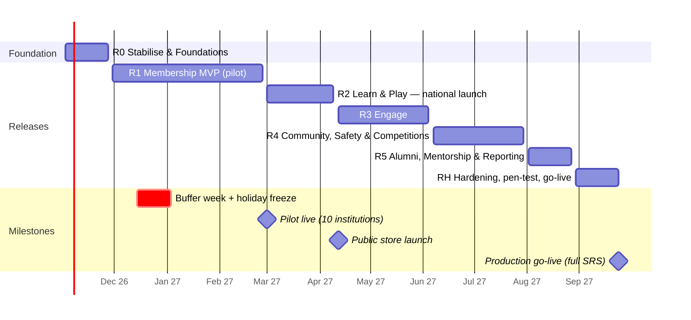

# 07 — Execution Plan

| | |
|---|---|
| Delivery model | Agile Scrum, 2-week sprints, 6 incremental releases + hardening |
| Duration | **S0 starts Mon 2 Nov 2026 → production go-live Fri 24 Sep 2027** (22 sprints; buffer week 14–18 Dec and holiday freeze 21 Dec–3 Jan), then 4 weeks hypercare |
| First users | **Pilot (10 institutions) from 1 Mar 2027**, **public App Store / Play Store launch 12 Apr 2027** |
| Scope | 100 SRS requirements (519 pts) + 20 foundation items (120 pts) = 639 pts against 770 pts of capacity (83 % planned load) |
| Detail | Every requirement's release, size and status is in `Requirements-Traceability-Matrix.xlsx` |

## 1. Sequencing principles

1. **Secure and stabilise before building.** The exposed credentials and broken migrations are fixed in week 1.
2. **Build shared engines once, early.** Workflow, Audience, Audit, Numbering, Scoped RBAC, Media, Cases and Notifications serve 60+ requirements. Building them per module would roughly double the effort.
3. **Identity first.** Every other module depends on verified members, institutions, clubs and roles (Module 1-3).
4. **Value early.** Learning + Quiz (the prototype's strongest area) gives a compelling public launch in R2.
5. **Safety before social.** No user-generated content goes live for minors until the moderation and safeguarding engine (SAF) ships. The prototype forum stays **disabled** in production until R4. Mentorship (adult↔minor contact) comes last, in R5, after safeguarding is proven in operation.
6. **Each release ends in a TRA UAT sign-off** on staging during the first week of the following sprint.

## 2. Roadmap

| Release | Sprints | Dates | SRS reqs | Points / capacity | Outcome |
|---|---|---|---:|---|---|
| **R0** Stabilise & Foundations | S0–S1 | 2 Nov – 27 Nov 2026 | 0 | 68 / 70 | Secure repo, CI/CD, test harness, shared engines, design system, app scaffold |
| **R1** Membership MVP | S2–S6 | 30 Nov 2026 – 26 Feb 2027 | 25 | 156 / 175 | Students register on the app, patrons/coordinators verify, members get a digital card with QR. Pilot |
| **R2** Learn & Play | S7–S9 | 1 Mar – 9 Apr 2027 | 19 | 95 / 105 | Approved learning content, modules with progress, quizzes with rules, points, badges, leaderboards. **Public launch** |
| **R3** Engage | S10–S13 | 12 Apr – 4 Jun 2027 | 23 | 111 / 140 | Events (RSVP, waitlist, QR check-in), Opportunities Hub, feedback, broadcasts and reminders |
| **R4** Community, Safety & Competitions | S14–S17 | 7 Jun – 30 Jul 2027 | 24 | 134 / 140 | Moderation & safeguarding engine, Ask-TRA Q&A, discussion spaces, competitions, rewards, verifiable certificates |
| **R5** Alumni, Mentorship & Reporting | S18–S19 | 2 Aug – 27 Aug 2027 | 9 | 65 / 70 | Alumni directory & sessions, mentorship with safeguarding, programme dashboards |
| **RH** Hardening & Go-live | S20–S21 | 30 Aug – 24 Sep 2027 | — | 10 / 70 | Pen test, load test, final regression & UAT, migration, go-live. Spare capacity absorbs defects |

**R4 is the tightest release (96 % load).** If velocity after S5 is below 33 points, move CMP-REQ01-05 (competitions) into RH and run the first national competition on the quiz engine alone.

## 3. Release scope and exit criteria

### R0 — Stabilise & Foundations (S0–S1)
**S0 (2–13 Nov)**
- Day 1–2: rotate all exposed credentials; delete `sftp.json` and the zips; purge history; make the repo private; turn on secret scanning (doc 05 §2).
- Single Laravel 13 app in `backend/` (web + API, ADR 001), Docker Compose dev stack, `.env.example` hygiene. Flutter app repo/folder created for mobile.
- Fix migrations (D1, D2), route bug (D3), lockfile (D4). Seed roles and permissions properly (D6, D7).
- CI: lint (Pint, ESLint), PHPUnit with MySQL service, TS type-check, gitleaks, Composer/npm audit, build.
- Architecture sign-off workshop with TRA ICT. Kick off procurement items (§7).

**S1 (16–27 Nov)**
- Shared services: Audit Log, Numbering, Publishing Workflow, Scoped RBAC + Policies.
- OpenAPI generation + `packages/api-client`.
- Flutter app scaffold (navigation, auth shell, en/sw i18n, theming, offline cache); Livewire admin shell replacing the React admin.
- UX: design system and R1 journeys in Figma; guerrilla usability test with 8–10 students and 2 patrons.

*Exit:* no secrets in repo or history; CI green; `migrate:fresh --seed` works; staging environment live; baseline feature tests for existing endpoints; ADRs 001–006 merged.

### R1 — Membership MVP (S2–S6)
| Sprint | Focus | Requirements |
|---|---|---|
| S2 (30 Nov–11 Dec) | Institutions & master data; registration API + app flow | INS-REQ01-03, REG-REQ01, MEM-REQ04 (statuses) |
| S3 (4–15 Jan) | Verification queue (scoped), activation, numbering, login hardening | REG-REQ02-04, MEM-REQ01, INS-REQ06 |
| S4 (18–29 Jan) | Notifications core (templates en/sw, SMS + email + push + in-app inbox), recovery | NOT-REQ01, NOT-REQ02, NOT-REQ06, REG-REQ05 |
| S5 (1–12 Feb) | Profile, privacy, digital card & QR verification, clubs & patrons | PRO-REQ01-03, MEM-REQ02-03, INS-REQ04-05 |
| S6 (15–26 Feb) | Account status admin, alumni transition, search & stats; Audience, Media, Case engines; pilot readiness | REG-REQ06-07, INS-REQ07-08 |

**14–18 Dec buffer week:** defect fixing, tech debt, pilot preparation (no new scope).

*Exit:* end-to-end "register → verify → activate → card → verify card" passes on Android, iOS and web; scoped coordinator access proven; pilot institutions onboarded; TestFlight + Play internal track builds; R1 UAT signed.

### R2 — Learn & Play (S7–S9)
| Sprint | Focus | Requirements |
|---|---|---|
| S7 | Content authoring, versions, review & publish, categories & targeting | LRN-REQ01-04, LRN-REQ08 |
| S8 | Member learning experience, modules & progress, search; quiz authoring & review | LRN-REQ05-07, GAM-REQ01-04 |
| S9 | Quiz taking (timer, limits, autosave), scoring rules, points ledger, badges, leaderboards, preferences | GAM-REQ05-10, NOT-REQ05 |

*Exit:* store listings approved (en/sw); prototype content and quiz data migrated; minors shown correctly on leaderboards; load test of 2,000 concurrent quiz submissions passes NFR-02; **public launch**.

### R3 — Engage (S10–S13)
- S10: Events create/review/publish/target, RSVP — EVT-REQ01-04
- S11: Capacity & waitlist, QR check-in (patron app mode), materials, close-out summary — EVT-REQ05-08
- S12: Opportunities create/review/publish, hub, eligibility, bookmarks, career resources — OPP-REQ01-07
- S13: Broadcasts, reminders, delivery tracking/retry; Feedback on Case engine; opportunity analytics; platform administration — NOT-REQ03/04/07, FBK-REQ01-04, OPP-REQ08

*Exit:* a national campaign event run end-to-end on staging with 500 synthetic registrants; broadcast to 100k test recipients in ≤ 30 min (NFR-15).

### R4 — Community, Safety & Competitions (S14–S17)
- S14: **Safety first**: reporting, moderation queue, content actions, account restrictions — SAF-REQ01-04 (COM-REQ07/08 traced here)
- S15: Minor safeguarding controls & escalation, safety reporting; Ask-TRA Q&A pipeline — SAF-REQ05-06, COM-REQ01-04
- S16: Discussion spaces, posts/replies, collaboration groups; competition create/review/publish/register — COM-REQ05/06/09, CMP-REQ01-03
- S17: Competition entries, scoring & results approval, rewards, certificates & public verification — CMP-REQ04-05, RWD-REQ01-02, CER-REQ01-02

*Exit:* Safeguarding Officer SOP approved by TRA; moderation team trained; community enabled for pilot institutions first; certificate verification page tested by an external party.

### R5 — Alumni, Mentorship & Reporting (S18–S19)
- S18: Alumni profile, directory, sessions; mentor applications; mentorship requests — ALM-REQ01-03, MNT-REQ01-02
- S19: Matching with safeguarding checks, engagement tracking, closure, safeguarding monitoring; programme dashboards (proposed M13) — MNT-REQ03-06

### RH — Hardening & Go-live (S20–S21)
Independent penetration test and fixes, DAST, load/soak test, accessibility audit, full regression (automated + manual), final UAT, production data migration rehearsal ×2, runbooks, go-live checklist (doc 08 §5), then 4 weeks hypercare with daily triage.

## 4. Team and roles

| Role | FTE | Responsibility |
|---|---:|---|
| Product Owner (TRA, Taxpayer Education) | 0.5 | Backlog priority, acceptance, decisions register |
| TRA Business Analyst / SME coordinator | 0.5 | Refinement, acceptance criteria from SRS, UAT scripts |
| Delivery Manager / Scrum Master | 1 | Plan, ceremonies, risks, reporting |
| Tech Lead / Architect | 1 | Architecture, code review, shared engines, security |
| Backend developers (Laravel) | 2 | API, domain modules, jobs |
| Mobile developers (Flutter) | 2 | iOS and Android apps |
| Laravel front-end developer (Blade/Livewire/Tailwind) | 1 | Public website (SEO), member portal, Administration Portal |
| UI/UX designer | 1 (0.5 after R2) | Design system, journeys, usability tests with students |
| QA engineers | 2 (1 manual/UAT, 1 automation) | Test design, automation (Pest/PHPUnit, Playwright, Maestro), regression |
| DevOps engineer | 0.5 | Infrastructure, CI/CD, monitoring, backups |
| Security specialist | 0.25 | Threat modelling, reviews, pen-test coordination |

Total ≈ 12.25 FTE → about **130 person-months** over 10.5 months, plus external pen test.
Velocity planning assumption: 35 points/sprint (6 developers incl. tech lead). Re-baseline after S3 with measured velocity.

### RACI (key activities)

| Activity | PO (TRA) | BA/SME (TRA) | Delivery Mgr | Tech Lead | Dev team | QA | TRA ICT Security | TRA Legal/DPO |
|---|---|---|---|---|---|---|---|---|
| Backlog priority | **A** | R | C | C | I | I | I | I |
| Business-rule decisions (doc 09) | **A** | R | C | C | I | I | C | C |
| Architecture & tech choices | C | I | I | **A/R** | C | I | C | I |
| Build & unit/feature tests | I | I | C | A | **R** | C | I | I |
| System & regression testing | I | C | C | C | C | **A/R** | I | I |
| UAT | **A** | R | C | I | C | R | I | I |
| Security testing & sign-off | I | I | C | R | C | C | **A** | I |
| Privacy/DPIA & consent texts | C | R | I | C | I | I | C | **A** |
| Production release approval | **A** | C | R | R | I | C | C | I |

## 5. Governance and ceremonies

| Forum | Cadence | Participants | Output |
|---|---|---|---|
| Sprint planning / review / retro | 2-weekly | Team + PO | Sprint goal, demo, improvements |
| Backlog refinement | Weekly | PO, BA, Tech Lead, QA | Stories meeting Definition of Ready |
| Decisions clinic | Weekly (S0–S6), then fortnightly | PO, BA, SMEs, Legal/DPO as needed | Closed items in doc 09 |
| Steering committee | Monthly | TRA sponsor, PO, ICT, Delivery Mgr | Status, risks, scope changes |
| Change Advisory | Per release | TRA ICT, Tech Lead, PO | Production approval |

**Definition of Ready:** story traced to an SRS ID; acceptance criteria written from the SRS *Related Requirements* + *Exceptional* rows; blocking decisions closed; UX designed (for UI stories); dependencies available.

**Definition of Done:** code reviewed; automated tests at the right level (feature tests for every API rule, including exceptional conditions); OpenAPI updated; en/sw strings complete; accessibility checked; audit events emitted; deployed to staging; QA passed; RTM status updated.

**Status reporting:** a burn-up per release, RTM coverage (Planned → Done → Accepted), open decisions, top risks, and defect trend, sent every sprint review.

## 6. Risk register (top 12)

| # | Risk | L | I | Mitigation | Owner |
|---|---|---|---|---|---|
| R-01 | Exposed credentials already exploited (server compromise) | M | H | Rotate immediately; review FTP/server logs; rebuild server from clean image if in doubt | TRA ICT |
| R-02 | Business-rule decisions (≈ 20 open) delay acceptance criteria | H | H | Decisions register with owners and due dates tied to sprints; default proposals pre-drafted | PO |
| R-03 | Child-safeguarding incident on the platform | M | H | Safety-before-social sequencing; no DMs; moderation SOP and staffing before R4 go-live | PO + Safeguarding Officer |
| R-04 | Apple/Google organisation accounts delayed (D-U-N-S, government verification) | M | H | Start in S0; use TestFlight/internal tracks for pilot | Delivery Mgr |
| R-05 | SMS gateway / sender ID approval delays (needed for OTP) | M | H | Procure in S0; email + push fallback; mock gateway in dev | TRA ICT |
| R-06 | Hosting environment not ready (TRA DC / gov cloud) | M | H | Containerised build runs anywhere; interim staging on approved cloud | TRA ICT |
| R-07 | Low-end devices & connectivity hurt adoption | M | M | NFR-04/05 budgets in CI; device lab of 5 low-end Android phones; pilot feedback | Tech Lead |
| R-08 | Velocity below plan | M | M | Re-baseline at S3; R4 descoping option (§2); keep RH buffer | Delivery Mgr |
| R-09 | Verification bottleneck (patrons/coordinators not acting on queues) | M | M | Bulk approve with checks; SLA reminders; dashboards per region | PO |
| R-10 | Moderation workload exceeds staff capacity | M | M | Phased community roll-out by institution; keyword pre-filters; volunteer patron moderators | PO |
| R-11 | Scope creep from new stakeholder requests | H | M | Change control via steering committee; new items join backlog for later releases | PO |
| R-12 | Data migration from prototype loses history | L | M | Two rehearsals; reconciliation counts; keep legacy IDs | Tech Lead |

## 7. Early procurement and dependencies (start in S0)

| Item | Needed by | Lead time | Owner |
|---|---|---|---|
| Apple Developer Program (organisation) + D-U-N-S number for TRA | S6 (TestFlight pilot) | 2–6 weeks | TRA ICT |
| Google Play Console (organisation) | S6 | 1–3 weeks | TRA ICT |
| SMS gateway contract + sender ID registration (e.g. "TRA-TAXCLUB") | S4 | 4–8 weeks | TRA ICT / Procurement |
| Firebase project (FCM) + APNs key | S4 | days | Tech Lead |
| SMTP relay / email domain (SPF, DKIM, DMARC) | S4 | 1–2 weeks | TRA ICT |
| Staging + production hosting, domains, TLS certificates | S1 (staging), S6 (prod pilot) | 2–8 weeks | TRA ICT |
| Pen-test vendor | S20 | 4–6 weeks | TRA ICT Security |
| DPIA, privacy notice, terms, guardian consent texts (en/sw) | S2 | 4 weeks | TRA Legal / DPO |
| Institution master list (name, category, region, district) | S2 | 2 weeks | Tax Club Programme Office |

## 8. Immediate next steps (next 10 working days)

1. **Today:** rotate the FTP passwords and backend secrets; delete the exposed files; make the repo private.
2. Nominate the Product Owner and BA; schedule the architecture sign-off and decisions clinic.
3. Review docs 01–09 with TRA ICT and the Tax Club Programme Office; confirm the stack (doc 02 §3) and the release plan.
4. Start the procurement items in §7.
5. Approve the new dependencies listed in doc 02 §3 (backend `CLAUDE.md` requires approval).
6. Begin S0 on Mon 2 Nov 2026.
