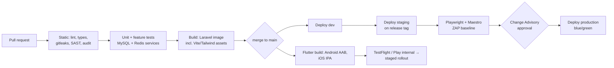

# 08 — DevOps, Environments and Deployment

## 1. Source control
- **Private** GitHub repository (after the history purge, doc 05 §2), branch protection on `main`: PRs only, CI required, signed commits recommended.
- Trunk-based: short-lived branches `feat/<REQ-ID>-short-name`, `fix/…`; commit messages reference SRS IDs (`REG-REQ02: add verification queue`).
- Releases tagged `vR1.0.0`; mobile builds carry `version` + `buildNumber` from the tag.
- `CODEOWNERS`: tech lead on `app/Domain/Shared`, security reviewer on auth/RBAC/safeguarding paths.

## 2. CI/CD pipeline (GitHub Actions)

| Artefact | Build | Deploy |
|---|---|---|
| API | Docker image (php-fpm 8.3 + nginx), `composer install --no-dev`, `config:cache`, `route:cache` | Blue/green or rolling on container host; `php artisan migrate --force` as a pre-deploy job; queue workers and scheduler as separate containers |
| Web front end | `npm ci && npm run build` (Vite + Tailwind) inside the API image build | Served by the same Laravel app: public site at `/` and `/en`, member portal at `/app`, admin at `/admin`. Hashed assets under `/build` cached for 1 year |
| Mobile | Flutter build in CI (Codemagic or GitHub Actions macOS runner) with signing keys in the secret store | TestFlight / Play internal → closed testing (pilot) → staged production rollout 10 % → 50 % → 100 % |

**FTP deployment and `uploadOnSave` are retired.** Production changes happen only through the pipeline.

## 3. Environments and infrastructure

| Component | Dev | Staging/UAT | Production |
|---|---|---|---|
| API containers | 1 | 2 | ≥ 3 (autoscale / N+1) |
| Queue workers | 1 | 1 | 2–4 (Horizon-supervised) |
| Scheduler | 1 | 1 | 1 (leader lock via Redis) |
| MySQL 8 | single | single | primary + replica, automated backups, PITR |
| Redis 7 | single | single | HA (sentinel or managed) |
| Object storage | MinIO | MinIO / bucket | Encrypted bucket + CDN, versioning |
| Secrets | `.env` (local only) | Secret manager / CI secrets | Secret manager (Vault or cloud KMS); **never** in repo or images |
| Monitoring | — | Sentry, logs | Sentry, centralised logs, uptime, Pulse, DB slow query log, alert routing |

Hosting location (TRA data centre vs government/cloud) is decision D-01. The containerised design runs on any of them.

## 4. Operational runbooks (delivered by RH)
Deploy and rollback, DB migration failure, queue backlog, SMS provider outage (fail over to push + email), push credential rotation, certificate/key rotation, safeguarding emergency (take down content, freeze accounts, notify officers), data-subject request handling, backup restore, incident communication template.

## 5. Go-live checklist (excerpt)
- [ ] Pen test: no open Critical/High; ZAP clean on production config
- [ ] `APP_DEBUG=false`, `APP_ENV=production`, HTTPS only, HSTS, CSP on admin
- [ ] Rotated production secrets; admin accounts with MFA; seed accounts removed
- [ ] Backups verified with a restore; RPO/RTO test recorded
- [ ] Monitoring alerts tested end-to-end; on-call rota published
- [ ] Data migration rehearsal ×2 reconciled (counts per table, membership numbers, points balances)
- [ ] Store listings (en/sw), privacy policy URL, data-safety forms, age rating
- [ ] Support desk scripts, FAQ, patron/coordinator training completed
- [ ] Safeguarding Officer and moderators rostered; SOP signed
- [ ] Rollback plan approved by Change Advisory
